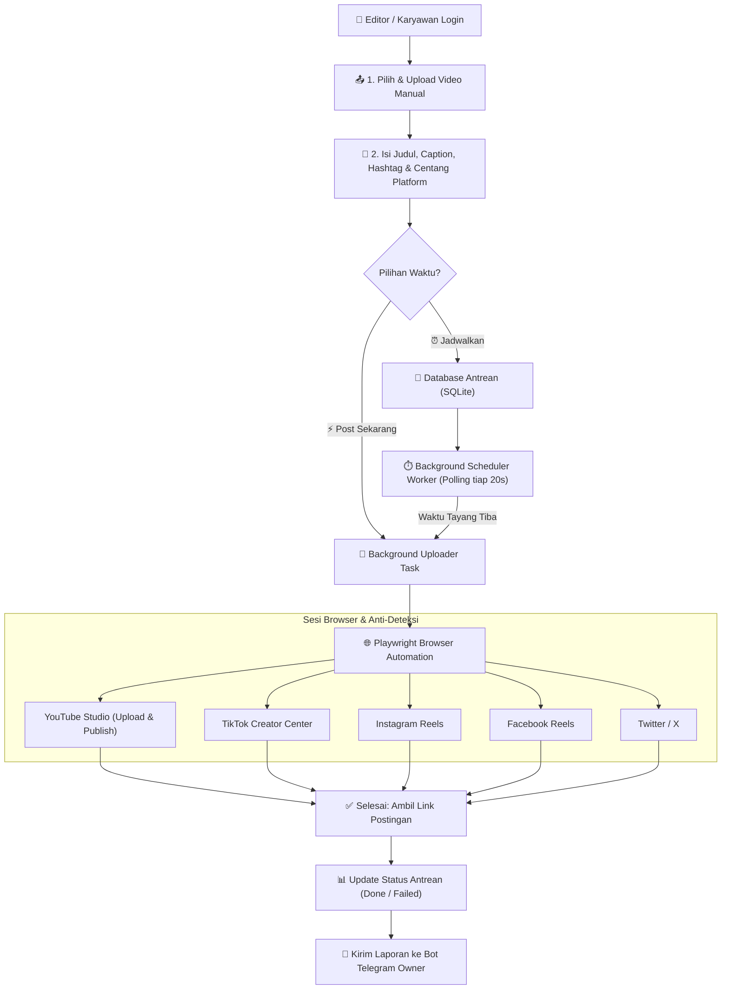

# 🚀 Sin'X Manual Poster — Studio Publikasi Sosmed Multi-Platform

Aplikasi web dashboard & otomasi browser modern untuk **mengunggah video hasil editan manual** secara serentak ke berbagai platform media sosial (YouTube Shorts, TikTok, Instagram Reels, Facebook Reels, Twitter/X, Febspot, Upscrolled) dengan dukungan **Jadwal Tayang (Scheduler)**, **Isolasi Akun Karyawan**, dan **Notifikasi Bot Telegram**.

---

## 📌 Mengapa Aplikasi Ini Dibuat?

Jika bot otomatis (*auto-scraper*) mengambil video orang lain secara acak lalu memotongnya, **Sin'X Manual Poster** dirancang khusus untuk **tim konten kreator & video editor** yang ingin:
1. Mengunggah video berkualitas tinggi (.mp4, .mov, .webm) yang sudah diedit manual di Premiere/CapCut.
2. Menentukan judul, caption/deskripsi khusus, dan hashtags yang relevan.
3. Memilih platform target mana saja yang ingin diposting hanya dengan sekali klik.
4. Memilih waktu tayang: **⚡ Langsung Upload (Instan)** atau **⏰ Jadwal Tayang (Scheduled)**.
5. Membagi akses akun ke **karyawan/editor** tanpa takut cookies atau channel YouTube/TikTok mereka tertukar.

---

## 🏗️ Diagram Alur Kerja (Workflow)



---

## 🌟 Fitur Utama

- **🎨 Modern Cyber-Claymorphism UI**: Dashboard web responsif dan elegan dengan dark mode 3D tactile theme.
- **⚡ Direct Multi-Platform Publisher**: Mengunggah 1 file video ke YouTube, TikTok, Instagram, Facebook, dan Twitter sekaligus dalam 1 kali klik.
- **⏰ Smart Background Scheduler**: Pengaturan tanggal dan jam tayang otomatis dengan zona waktu WIB (Asia/Jakarta).
- **👥 Multi-Tenant Employee Isolation**: Akun admin dan karyawan terisolasi. Cookies, antrean video, dan riwayat posting milik karyawan A tidak bisa diakses atau tertukar dengan karyawan B.
- **🛡️ Human Behavior Anti-Detection**: Menggunakan *Camoufox / Chromium Stealth*, random delay pengetikan keyboard, dan jeda antar platform untuk mencegah pemblokiran akun.
- **📲 Live Log Terminal (SSE)**: Streaming log real-time eksekusi browser Playwright langsung di layar dashboard.
- **🤖 Laporan Bot Telegram**: Notifikasi instan beserta tautan langsung (`https://youtu.be/...`, `https://tiktok.com/...`) setiap kali postingan berhasil dipublikasikan.

---

## 📁 Struktur Direktori

```
sinx-manual-poster/
├── assets/
│   └── profiles/               # Penyimpanan sesi browser & cookies per akun
├── data/
│   └── manual_poster.db        # Database SQLite (otomatis dibuat)
├── uploads/                    # Folder penyimpanan file video yang diunggah
├── poster/
│   ├── config.py               # Konfigurasi sistem & environment
│   ├── auth.py                 # Otentikasi pengguna & hashing SHA-256
│   ├── db/
│   │   ├── models.py           # Skema tabel database SQLite
│   │   └── queue.py            # Operasi query database
│   ├── modules/
│   │   ├── publisher/          # Engine Playwright per platform (YT, TikTok, IG, FB, dll.)
│   │   ├── uploader.py         # Orkestrator distribusi multi-platform
│   │   ├── scheduler.py        # Background task pemantau jadwal tayang
│   │   └── telegram_notifier.py# Pengirim pesan hasil upload ke Telegram
│   └── utils/
│       ├── logger.py           # Logger sistem dengan format warna
│       └── human_delay.py      # Simulasi jeda interaksi manusia alami
├── web/
│   ├── server.py               # Backend FastAPI & REST API
│   └── static/                 # Frontend SPA (HTML5, Clay CSS, JS)
│       ├── css/clay.css        # Desain Cyber-Claymorphism 3D
│       ├── js/app.js           # Logika interaktif frontend
│       ├── js/toast.js         # Sistem notifikasi 3D toast
│       └── js/lucide.min.js    # Ikon vektor offline
├── config.yaml                 # Konfigurasi platform default
├── requirements.txt            # Dependensi library Python
├── manage.py                   # Script CLI manajemen server & user
└── run.bat                     # 1-klik jalan otomatis di Windows
```

---

## 🚀 Panduan Instalasi & Menjalankan

### Cara Cepat (Windows):
Cukup **klik dua kali berkas `run.bat`**. 
Script akan otomatis:
1. Mendeteksi instalasi Python di sistem Anda.
2. Memeriksa dan menginstal paket di `requirements.txt` jika belum ada.
3. Menjalankan server web dashboard di port `8090`.

### Cara Manual via Terminal:
1. Pastikan Python 3.10+ sudah terpasang.
2. Buka terminal (PowerShell atau Command Prompt) di folder ini:
   ```powershell
   cd C:\Users\ji70\Documents\sinx-manual-poster
   ```
3. Pasang paket dependensi:
   ```powershell
   pip install -r requirements.txt
   playwright install chromium firefox
   ```
4. Jalankan aplikasi:
   ```powershell
   python manage.py run-web
   ```
5. Buka peramban di alamat:
   👉 **`http://localhost:8090`**

---

## 🔑 Akun Login Bawaan (Default)

Saat pertama kali dibuka, masuk dengan akun Administrator bawaan:
- **Username**: `adminkd`
- **Password**: `admin123` (atau hash BCrypt `$2a$10$XDWXg3CgGcwSyIiHP6AS7uJJZhuhIy3LtyV1XnEjiwAwfS68r8wwK`)

*(Setelah masuk, Anda dapat membuat akun untuk karyawan lain di tab **Kelola Karyawan**).*

---

## 🍪 Panduan Menyiapkan Cookies Sosmed

Agar bot dapat memposting ke akun sosial media Anda tanpa meminta login terus-menerus:

### Langkah Ekspor Cookies dari Browser:
1. Pasang ekstensi Chrome/Edge: **Get cookies.txt LOCALLY** atau **EditThisCookie**.
2. Buka dan login ke akun target di browser Anda:
   - YouTube Studio (`https://studio.youtube.com`)
   - TikTok (`https://www.tiktok.com`)
   - Instagram (`https://www.instagram.com`)
   - Facebook (`https://www.facebook.com`)
3. Buka ekstensi dan klik **Export / Copy** (format JSON atau Netscape TXT).
4. Simpan ke file di komputer Anda (misal `youtube_cookies.json`).

### Langkah Unggah ke Dashboard:
1. Buka tab **Akun & Cookies** di Sin'X Manual Poster.
2. Pada kartu platform yang sesuai, klik **Upload Cookies (.json / .txt)**.
3. Status platform akan langsung berubah menjadi badge hijau: **Sesi Aktif (Ready)**.

---

## ⚙️ Konfigurasi Notifikasi Bot Telegram

Untuk menerima laporan otomatis setiap kali video berhasil diunggah:
1. Hubungi `@BotFather` di Telegram untuk membuat bot dan salin **Bot Token** Anda.
2. Dapatkan Chat ID Anda via `@userinfobot`.
3. Buka tab **Konfigurasi** di Dashboard:
   - Aktifkan toggle **Notifikasi Bot Telegram**.
   - Masukkan **Telegram Bot Token** dan **Telegram Chat ID**.
   - Klik **Tes Kirim Pesan** untuk memastikan bot terhubung.
   - Klik **Simpan Pengaturan**.

---

## 💻 Panduan Perintah CLI (`manage.py`)

Selain melalui antarmuka web, Anda dapat mengelola aplikasi melalui terminal:

| Perintah | Deskripsi |
| :--- | :--- |
| `python manage.py run-web` | Menjalankan server web dashboard dan background scheduler |
| `python manage.py create-user -u <user> -p <pass>` | Menambahkan akun karyawan atau admin baru |
| `python manage.py list-users` | Melihat daftar semua user yang terdaftar |
| `python manage.py status` | Menampilkan ringkasan statistik antrean video |
| `python manage.py reset-stuck` | Meriset postingan yang macet dengan status `uploading` kembali ke `scheduled` |
| `python manage.py info` | Memeriksa spesifikasi hardware, GPU encoder, dan direktori |

---

## 🛡️ Keamanan & Privasi

1. **Password Terenkripsi**: Password karyawan dan admin di-hash menggunakan algoritma SHA-256 dengan salt unik.
2. **Karantina Sesi**: Folder sesi browser (`assets/profiles/user_<id>/`) dipisahkan secara fisik di disk, menjamin tidak ada kebocoran cookies antar karyawan.
3. **Penyimpanan Lokal**: Semua video dan database tersimpan di komputer/server Anda sendiri, bukan di cloud pihak ketiga.

---

## 📄 Lisensi & Hak Cipta
Dibuat untuk keperluan otomatisasi studio kreator **Sin'X Automation**.
